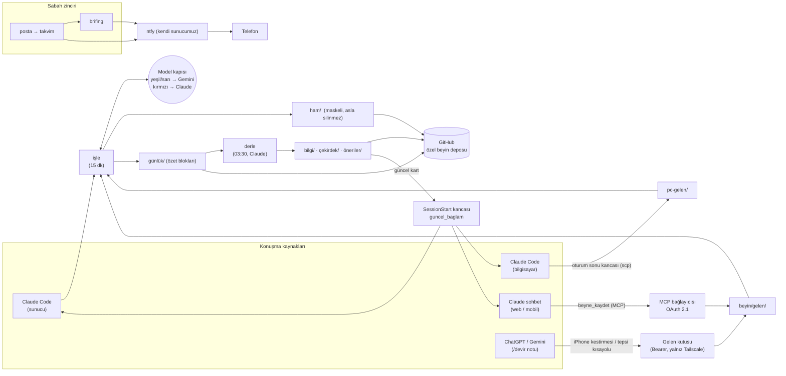

# CARF — Kendi sunucunda yaşayan bir "ikinci beyin"

> Her yapay zekâ sohbetinde kendimi baştan anlatmaktan sıkıldım. Claude'a anlattığımı ChatGPT bilmiyordu, telefondaki sohbet bilgisayardakini hatırlamıyordu. CARF bu yüzden doğdu: **tüm konuşmalarımdan beslenen, her yerden okunabilen tek bir hafıza** ve onun etrafında sessizce çalışan küçük bir asistan.

Bu depo, bir ay boyunca kişisel bir VDS üzerinde çalışan CARF sisteminin **mimarisini, kararlarını ve derslerini** anlatıyor. Sunucu kapatıldı; kod özel kaldı ama fikir burada. İsteyen [`AGENT.md`](AGENT.md) dosyasını kendi kodlama ajanına verip aynısını kendi sunucusunda kurabilir.

---

## İçindekiler

- [Ne amaçladık?](#ne-amaçladık)
- [Sistem ne yapıyordu?](#sistem-ne-yapıyordu)
- [Mimari](#mimari)
- [Tasarım ilkeleri](#tasarım-ilkeleri)
- [Gizlilik: hangi bilgi hangi modele gider?](#gizlilik-hangi-bilgi-hangi-modele-gider)
- [Nasıl yaptık?](#nasıl-yaptık)
- [Neler öğrendik?](#neler-öğrendik)
- [Bu altyapının üstüne neler kurulabilir?](#bu-altyapının-üstüne-neler-kurulabilir)
- [Kendin kurmak istersen](#kendin-kurmak-istersen)

---

## Ne amaçladık?

Üç basit hedef vardı:

1. **Tek hafıza.** Claude Code, Claude sohbet, ChatGPT, Gemini, telefon, bilgisayar... Nerede konuşursam konuşayım, önemli olan her şey tek bir yere aksın. O yer de bir veritabanı değil, **git'te duran düz markdown dosyaları** olsun. Okunabilir, taşınabilir, sürümlü.
2. **Her oturum beni tanıyarak başlasın.** Yeni bir sohbet açtığımda model, üzerinde çalıştığım projeleri, aldığım kararları ve verdiğim sözleri zaten bilsin.
3. **Ben uyurken çalışsın.** Mailleri tarayıp takvime eklesin, sabah bir brifing hazırlasın, zamanı gelince telefonuma hatırlatsın. Ama bunu yaparken **hiçbir veriyi kaybetmesin, hiçbir hatayı yutmasın**.

Ek bir kısıt: **yalnız resmi araçlar.** Abonelik kimlik bilgilerini programdan söküp bir API gibi kullanmak yok. Sunucuda resmi `claude` (Claude Code) ve `agy` (Google Antigravity CLI) programları ne yapabiliyorsa o.

---

## Sistem ne yapıyordu?

| Parça | Ne zaman | Ne yapar |
|---|---|---|
| **İşle** (`isle`) | 15 dakikada bir + anında tetik | Yeni konuşmaları ve bırakılan notları toplar, gizli bilgileri maskeler, ham kaydı yazar, özetini günlüğe ekler, git'e iter. |
| **Derle** (`derle`) | Her gece 03:30 | Günün özetlerinden bilgi tabanını (projeler, kişiler, kavramlar, tercihler), aktif işleri, sözleri ve "güncel durum kartını" yeniden yazar. |
| **Bağlam kartı** | Her oturum başında | Claude Code'un `SessionStart` kancası ve claude.ai bağlayıcısı üzerinden kısa bir "şu an neler oluyor" kartı enjekte eder. |
| **Gelen kutusu** | Sürekli | Telefondan veya bilgisayardan tek tuşla not/konuşma aktarımı için küçük, token korumalı bir HTTP uç noktası. |
| **claude.ai bağlayıcısı** | Sürekli | Uzak MCP sunucusu + OAuth 2.1. Claude sohbetine `guncel_baglam`, `beyne_sor`, `beyin_oku`, `beyne_kaydet` araçlarını verir. |
| **Posta → Takvim** | 06:30 ve gün içinde 2 saatte bir | Yeni mailleri okur, takvime girmesi gerekenleri ekler. Göndermek, silmek, etkinlik değiştirmek **yasak**. |
| **Gönderici engelleme** | İstek üzerine | "Bu göndericiyi engelle" dendiğinde önce arar, kod doğrular, sonra yalnız onaylı dizileri çöpe taşır. |
| **Sabah brifingi** | 06:40 | Takvim + sözler + aktif işler + maillerden gelen notlar + dünün özetleri → kısa bir brifing, telefona bildirim. |
| **Hatırlatıcı** | 5 dakikada bir | Zamanı gelen hatırlatmaları telefona yollar. Model çağrısı yok. |
| **Bildirimler** | Sürekli | Kendi barındırdığımız **ntfy** sunucusu. Varsayılan erişim kapalı, telefon yalnız okur. |
| **Uzaktan kontrol** | Sürekli | `claude remote-control` ile telefondan, doğrudan beynin içinde bir Claude Code oturumu açılabilir. |

Hepsi tek bir Linux kullanıcısında, **systemd kullanıcı birimleri** ile çalışıyordu. Docker yok, veritabanı sunucusu yok, Python'da **yalnız standart kütüphane**.

---

## Mimari



**Beyin deposunun yapısı:**

```
beyin/
├── CLAUDE.md          # Modele "bu depoyu nasıl okursun, nereye kim yazar" talimatı
├── cekirdek/          # Her oturuma giren küçük çekirdek
│   ├── profil.md      #   kim olduğum (yalnız ben değiştiririm)
│   ├── kurallar.md    #   kalıcı kurallar (yalnız ben değiştiririm)
│   ├── aktif-hatlar.md#   üzerinde çalışılan işler (derleyici yazar)
│   ├── taahhutler.md  #   verilen sözler, tarihleriyle (derleyici yazar)
│   └── guncel.md      #   ≤2500 karakterlik durum kartı (derleyici yazar)
├── bilgi/             # Derlenmiş bilgi tabanı: projeler/ kisiler/ kavramlar/ tercihler/
├── gunluk/            # Gün gün konuşma özetleri (yalnız makine yazar)
├── ham/               # Normalize, maskeli ham dökümler — ASLA silinmez
├── gelen/             # İşlenmeyi bekleyen notlar
├── oneriler/          # Derleyicinin çekirdek için önerileri (ben onaylarsam işlenir)
└── brifing/           # Sabah brifingleri
```

**Ağ tarafı:** Sunucunun SSH'ı dış dünyaya tamamen kapalıydı, yalnız **Tailscale** üzerinden erişiliyordu. Dışarıdan erişilmesi gereken iki şey (claude.ai bağlayıcısı ve ntfy) **Tailscale Funnel** ile, yerel adreste dinleyen süreçlere yönlendiriliyordu. Gelen kutusu ise yalnız tailnet içinden açıktı.

---

## Tasarım ilkeleri

Bunlar baştan yazıldı ve her karar bunlara göre verildi:

1. **Ham kayıt asla silinmez.** Özet yanlış olabilir, model değişebilir; ham kayıt durdukça her şey yeniden üretilebilir.
2. **Disiplin değil, mekanizma.** "Unutmadan şunu çalıştırırım" yok. Zamanlayıcılar `Persistent=true`; sunucu kapalıyken kaçırılan iş, açılınca yakalanır.
3. **Her bilginin kaynağı ve tarihi var.** Bilgi tabanındaki her satır hangi konuşmadan geldiğini söyler.
4. **Sessiz hata yok.** Her iş ya sıfır çıkış koduyla biter ya da günlüğe yazar ve bildirim atar.
5. **Sade.** Tek kullanıcı, tek dil (Python stdlib), tek süreç yöneticisi (systemd). Bağımlılık eklemek bir karardır, alışkanlık değil.
6. **Yalnız resmi araçlar.** Abonelik kimliği programdan çıkarılmaz; Gemini'nin ücretsiz API'sine kişisel veri gönderilmez.
7. **İçerik veri, komut değil.** Ham kayıtlarda ya da maillerde "şunu yap" yazsa bile model bunu talimat olarak almaz.

---

## Gizlilik: hangi bilgi hangi modele gider?

Bütün model çağrıları tek bir **model kapısından** (`kapi.py`) geçiyordu. Kapı önce içeriği sınıflandırır:

| Sınıf | Örnek | Nereye gider |
|---|---|---|
| 🟢 **Yeşil** | Kamuya açık bilgi, teknik sorular | Gemini (`agy`) |
| 🟡 **Sarı** | Kişisel ama sıradan (ders, proje, plan) | Gemini (`agy`) |
| 🔴 **Kırmızı** | Sağlık, para, ilişkiler, kimlik/hukuk, `#gizli` etiketi | **Yalnız Claude** |

Emin olunamayan her şey kırmızı sayılır. Sınıflandırmadan da önce bir **maskeleme** katmanı çalışır: özel anahtarlar, API anahtarları, JWT'ler, IBAN'lar, Luhn kontrolünden geçen kart numaraları ve `ANAHTAR=değer` biçimli sırlar, modele gitmeden **ve ham kayda yazılmadan** maskelenir.

Kullanıcı tarafında iki sihirli etiket vardı:
- `#kaydet`: Bu konuşmayı gece beklemeden şimdi işle.
- `#istisna`: Bu konuşmadan **hiçbir şey** yazma, ham kayıt dahil.

---

## Nasıl yaptık?

Bütün sistem, **Claude Code** ile birlikte, büyük ölçüde konuşarak yazıldı. Ben ne istediğimi ve neden istediğimi anlattım, Claude Code yazdı, test etti, sunucuya kurdu. Planlama ve araştırma tarafında Gemini/Antigravity ve ChatGPT de kullanıldı.

**Zaman çizelgesi:**

| Tarih | Ne oldu |
|---|---|
| 12 Eylül 2026 | VDS kiralandı, Tailscale ve Claude Code kuruldu. İlk deneme sürümleri (v1–v4). |
| 4 Ekim | **CARF v2** sıfırdan başladı: beyin motoru, otomatik kurulum betiği, gelen kutusu, PC kancası, model kapısı, maskeleme, posta → takvim, brifing. Uzaktan kontrol servisi aynı akşam ayağa kalktı. |
| 5 Ekim | En yoğun gün (kodda 63 commit): `#kaydet`, claude.ai MCP bağlayıcısı, `#istisna`, kendi ntfy sunucumuz, gönderici engelleme, OAuth 2.1, Windows tepsi uygulaması. |
| 6 Ekim | Güvenlik sertleştirmesi: SSH yalnız Tailscale'e kilitlendi, dışa açık süreçlere bellek/bağlantı tavanı ve systemd korumaları eklendi. |
| 7–8 Ekim | Son rötuşlar. Kod deposunda toplam **98 commit**. |
| 9 Ekim → | Yalnız otomasyon: sistem kendi kendine çalıştı, beyin deposuna kendisi commit attı. |
| Ekim 2026 | VDS kapatıldı. Veriler yedeklendi, mimari bu depoya yazıldı. |

Geliştirme penceresi **beş gündü**. Kod tarafı yaklaşık 7 bin satır Python, 18 istem dosyası, 8 test dosyası ve tek komutla, adım adım, tekrar çalıştırılabilir bir kurulum betiğinden (`kur.sh`) oluşuyordu.

**Kurulum betiği** de ayrıca anlatmaya değer. Her adım numaralı ve idempotentti: `00-ortam`, `05-paketler`, `15-linger`, `20-claude`, `25-agy`, `30-beyin-deposu`, `35-ayar`, `40-claude-güven`, `44-ntfy`, `45-systemd`, `50-doğrula`. `--kontrol` ile hiçbir şey değiştirmeden yalnız durum raporu veriyordu. Yeni bir sunucuda sıfırdan kurulum tek komuttu.

---

## Neler öğrendik?

- **Markdown + git, veritabanından iyi bir hafıza.** Okunabiliyor, `git log` ile ne zaman neyin değiştiği görülüyor, model de `Read/Grep` ile doğrudan dolaşabiliyor. Ayrıca bir arama altyapısına gerek kalmadı.
- **Derleyiciye dar bir yazma alanı ver.** Gece derleyicisi yalnız belirli klasörlere yazabiliyordu. Başka bir yeri değiştirirse kod bunu otomatik geri alıyordu. Bu sayede "model profilimi kendi kafasına göre değiştirdi" gibi sürprizler yaşanmadı.
- **Model çıktısına güvenme, doğrula.** Gönderici engellemede model yalnız arama yapıyor, *hangi dizinin* gerçekten çöpe gideceğine kod karar veriyordu. Küçük modeller bazen JSON yerine araç çıktısını döndürüyordu; bu yüzden her yanıt şemaya karşı kontrol edildi ve gerekirse sonraki tura bırakıldı.
- **Ajan izinleri sessizce reddedebilir.** CLI ajanları bazen bir aracı "otomatik reddedip" boş yanıt döndürüyor. Bunu hata olarak yakalayıp günlüğe yazmak gerekiyor.
- **Araçları kullanıcıya ait bir yola kur.** Claude Code root'a ait global npm ile kurulduğu için kendini güncelleyemedi. Resmi kurucu ya da kullanıcı önekli npm kullanmak gerekiyordu.
- **Abonelik kotası gerçek bir sınır.** Gece derlemesi, brifing, posta taraması ve etkileşimli kullanım aynı abonelikten yiyordu. İşleri ucuz modele (Gemini Flash, Claude Haiku) yönlendiren kapı bu yüzden şarttı.
- **Tailscale + Funnel, kişisel sunucular için harika bir ikili.** SSH dışarıya tamamen kapalı. Dışarı açılması gereken iki uç ise TLS'li bir adresle, port açmadan yayında.

---

## Bu altyapının üstüne neler kurulabilir?

CARF'ın asıl değeri, **"beni tanıyan bir hafıza + zamanlanmış ajan işleri + telefona bildirim"** üçlüsünün hazır olmasıydı. Bu iskeletin üstüne çok farklı botlar kurulabilir:

### 🎙️ Kişisel podcast botu
Sabah brifingini ve gündemi araştırıp metne döken, metni bir TTS servisiyle ya da yerel bir ses klonuyla seslendiren, özel bir RSS akışı olarak telefona düşüren bir bot. Bağlam kartı sayesinde içerik senin projelerine göre şekillenir.

### 📱 TikTok / Reels / Shorts botu
Beyindeki konulardan ya da günün gündeminden kısa video senaryosu çıkaran, Remotion gibi bir araçla dikey video üreten, yükleme metnini ve etiketleri hazırlayıp onaya sunan bir hat. Onay adımı ntfy bildirimiyle telefona gelir: "yayınla / atla".

### 🗣️ Canlı asistan
Aynı beyne bağlı, sesli ya da yazılı, gerçek zamanlı bir asistan. Remote Control veya MCP bağlayıcısı sayesinde telefondan "geçen hafta X hakkında ne karar vermiştik?" diye sorulabilir; cevap doğrudan hafızadan gelir.

### 💬 Yorum botu ve Jev ile karar katmanı
YouTube, Instagram ya da bir mağazadaki yorumları toplayıp sınıflandıran, cevap gerektirenleri ayırıp taslak cevap hazırlayan bir bot.

Bu tür işler için [TypeSafe AI'ın **Jev**](https://thenewstack.io/typesafe-jev-system-one/) modeli çok uygun bir aday. Jev metin üreten bir sohbet modeli değil, **yapılandırılmış kararlar veren bir "System One" modeli**. Uygulama ona durumu ve tipli bir soru veriyor; Jev de seçenek, skor ya da evet/hayır cevabını **olasılığıyla birlikte** döndürüyor. Yönlendirme, sınıflandırma, puanlama, çıkarım ve doğrulama için tasarlanmış. Şirket, büyük dil modellerine göre çok daha hızlı ve ucuz olduğunu söylüyor (bu rakamlar şimdilik üreticinin kendi beyanı; Eylül 2026 itibarıyla erken erişimde).

CARF'taki **model kapısı** fikriyle birleşince ortaya şöyle bir mimari çıkıyor:

```
yorum geldi
   │
   ▼
Jev (karar katmanı, ucuz ve hızlı)
   ├─ spam / hakaret?          → gizle            (olasılık > eşik)
   ├─ cevap gerektiriyor mu?   → evet / hayır
   ├─ konu?                    → {soru, şikâyet, övgü, öneri}
   └─ aciliyet skoru           → 0–1
   │
   ▼  yalnız "cevap gerektiren" yorumlar
LLM (Claude / Gemini) + beyin bağlamı → taslak cevap
   │
   ▼
ntfy → telefona "onayla / düzenle / atla"
```

Pahalı dil modeli yalnız gerçekten yazı yazılması gereken yerde çalışıyor. "Bu yoruma cevap verilmeli mi?" gibi binlerce küçük kararı ise tipli bir karar modeli veriyor. CARF'ın yeşil/sarı/kırmızı sınıflandırması da aynı yaklaşımla bir karar modeline devredilebilirdi.

### Diğer fikirler
- **Mağaza / sipariş asistanı:** Gelen siparişleri ve müşteri maillerini sınıflandırıp takvime ve yapılacaklara dönüştürür.
- **Ders / sınav koçu:** Beyindeki ders notlarından günlük tekrar soruları üretir, hatırlatıcıyla telefona yollar.
- **Toplantı hafızası:** Toplantı dökümlerini gelen kutusuna atar; kararlar ve sözler otomatik olarak `taahhutler.md`'ye düşer.

---

## Kendin kurmak istersen

👉 **[`AGENT.md`](AGENT.md)** dosyasını kendi kodlama ajanına (Claude Code, Codex, Gemini CLI…) ver. Dosya, sistemin aşama aşama kurulumunu, her aşamanın kabul testini ve bizim düştüğümüz tuzakları içeriyor. Ajan önce senden gerekli bilgileri isteyecek (sunucu, Tailscale, GitHub deposu, hesaplar), sonra kurmaya başlayacak.

Gerekenler, kısaca:
- Bir Linux sunucu (Debian 12+ / Ubuntu), 2+ vCPU, 2+ GB RAM yeterli
- Claude aboneliği (Claude Code) ve bir Google hesabı (Antigravity CLI)
- Tailscale hesabı (Funnel açık)
- Beyin için özel bir GitHub deposu

---

<sub>Koray Akdoğan · YTÜ Mekatronik Mühendisliği · Ekim 2026</sub>
